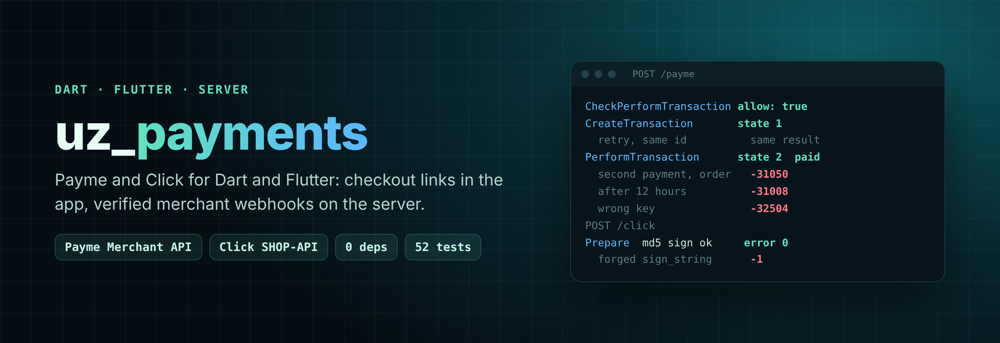

<p align="center">
  
</p>

<h1 align="center">uz_payments</h1>

<p align="center">
  <b>Payme and Click payments for Dart and Flutter, both client and server.</b><br>
  Checkout links in your app, plus <b>verified merchant webhooks</b> on your backend. Zero dependencies.
</p>

<p align="center">
  <a href="https://pub.dev/packages/uz_payments"></a>
  <a href="https://github.com/MBotirjonDev/uz_payments/actions/workflows/ci.yml"></a>
  
  
  
  <a href="LICENSE"></a>
</p>

<p align="center"><a href="#ozbekcha">🇺🇿 O'zbekcha</a> · <a href="#quick-start">Quick start</a> · <a href="#security">Security</a> · <a href="#roadmap">Roadmap</a></p>

---

Opening a checkout page is the easy part. The hard part, and where real money gets lost, is the **merchant API**: Payme and Click call *your* server to check the order, create the transaction, confirm it and sometimes cancel it. Done wrong, that means double charges, orders paid twice, refunds for goods already shipped, or a forged "paid" request accepted.

The existing Dart packages only build the payment link. **uz_payments implements the server side too**, following the official PHP reference templates from Payme and Click:

|                                               | uz_payments | other Dart packages |
| --------------------------------------------- | :---------: | :-----------------: |
| Payme checkout link                           | ✅ | ✅ |
| Click checkout link                           | ✅ | ✅ |
| **Payme Merchant API** (all 7 JSON-RPC methods) | ✅ | ❌ |
| **Click SHOP-API** (Prepare / Complete)       | ✅ | ❌ |
| Signature and auth checks in constant time    | ✅ | — |
| Exact money math in tiyin (no `double`)       | ✅ | ❌ |
| Idempotent retries, 12-hour timeout, refunds  | ✅ | — |
| Localized errors (ru / uz / en)               | ✅ | — |
| Works with any framework or database          | ✅ | — |

## Install

```yaml
dependencies:
  uz_payments: ^0.1.0
```

or run `dart pub add uz_payments` (`flutter pub add uz_payments` in a Flutter app).

## Quick start

### 1. In the Flutter app: open the checkout page

```dart
import 'package:uz_payments/checkout.dart'; // client-safe: no secrets, no server code
import 'package:url_launcher/url_launcher.dart';

final payme = PaymeCheckout(merchantId: '587f72c72cac0d162c722ae2');
await launchUrl(payme.url(
  account: {'order_id': '197'},
  amountTiyin: 50000, // 500 so'm
  lang: 'uz',
  returnUrl: 'https://shop.example/thanks',
));

final click = ClickCheckout(serviceId: 36, merchantId: 46);
await launchUrl(click.url(transactionParam: '197', amountTiyin: 50000));
```

Amounts are always **integers in tiyin** (1 so'm = 100 tiyin). Values that could inject extra parameters (`;` in a Payme account value) are rejected.

### 2. On the server: handle Payme and Click

```dart
import 'package:uz_payments/uz_payments.dart';

final payme = PaymeMerchantHandler(
  key: Platform.environment['PAYME_KEY']!,
  backend: MyPaymeBackend(db),   // your database, see below
  allowedIps: paymeIps,          // only accept Payme's servers
);

final click = ClickMerchantHandler(
  serviceId: 36,
  secretKey: Platform.environment['CLICK_SECRET']!,
  backend: MyClickBackend(db),
);

// In any HTTP framework:
final res = await payme.handle(MerchantRequest(headers: headers, body: body, remoteAddress: ip));
// → send res.statusCode, res.headers, res.body
```

The handlers are framework-agnostic: they take headers, body and IP, and return status, headers and body.

<details>
<summary><b>shelf</b></summary>

```dart
Future<Response> paymeRoute(Request req) async {
  final info = req.context['shelf.io.connection_info'] as HttpConnectionInfo?;
  final res = await payme.handle(MerchantRequest(
    headers: req.headers,
    body: await req.readAsString(),
    remoteAddress: info?.remoteAddress.address,
  ));
  return Response(res.statusCode, body: res.body, headers: res.headers);
}
```
</details>

<details>
<summary><b>dart_frog</b></summary>

```dart
Future<Response> onRequest(RequestContext context) async {
  final req = context.request;
  final res = await payme.handle(MerchantRequest(
    headers: req.headers,
    body: await req.body(),
    remoteAddress: req.connectionInfo.remoteAddress.address,
  ));
  return Response(statusCode: res.statusCode, body: res.body, headers: res.headers);
}
```
</details>

<details>
<summary><b>dart:io</b> (no packages)</summary>

See [`example/example.dart`](example/example.dart): a complete server for both providers in about 60 lines.
</details>

### 3. Connect your database

You implement a small interface; the handler owns the protocol and the state machine.

```dart
class MyPaymeBackend implements PaymeBackend {
  Future<PaymeOrder?> findOrder(Map<String, dynamic> account);          // order by account.order_id
  Future<PaymeTransaction?> findTransaction(String paymeId);
  Future<PaymeTransaction?> findOpenTransactionForOrder(String orderId);
  Future<PaymeTransaction> insertTransaction(PaymeTransaction tx);      // unique index on payme_id
  Future<void> perform(PaymeTransaction tx);   // in ONE db transaction: save tx + mark order paid
  Future<void> cancel(PaymeTransaction tx);    // in ONE db transaction: save tx + release order
  Future<bool> canCancelPerformed(PaymeTransaction tx);                 // false once goods are delivered
  Future<List<PaymeTransaction>> transactionsBetween(int from, int to); // GetStatement
}
```

`InMemoryPaymeBackend` and `InMemoryClickBackend` are reference implementations (about 40 lines each) to copy from, and are good enough for the Payme sandbox.

## What the handlers do for you

**Payme Merchant API.** `CheckPerformTransaction`, `CreateTransaction`, `PerformTransaction`, `CancelTransaction`, `CheckTransaction`, `GetStatement` and `ChangePassword`:

- Basic auth with `Paycom:<key>` compared in constant time; optional allowlist of Payme IPs (`paymeIps`)
- JSON-RPC 2.0 envelope with every documented error code (`-32700`, `-32600`, `-32601`, `-32504`, `-32400`, `-31001`, `-31003`, `-31007`, `-31008`, `-31050`)
- Retries of `CreateTransaction` / `PerformTransaction` / `CancelTransaction` return the same result
- One open transaction per order; a second payment attempt is refused while the first is pending
- Transactions older than 12 hours are cancelled with reason 4 and cannot be performed
- Refund after payment only if `canCancelPerformed` allows it, otherwise `-31007`
- Fiscal receipt `detail` passes through from your order
- Unexpected errors become `-32400` without leaking stack traces or SQL

**Click SHOP-API.** Prepare (action 0) and Complete (action 1):

- MD5 `sign_string` verified in constant time *before* anything touches your database
- `service_id` must match yours; amount compared exactly in tiyin (`"1000"` equals `"1000.00"`, `"999.99"` does not)
- Repeated Prepare returns the same `merchant_prepare_id`; repeated Complete returns `-4 Already paid`
- A Complete carrying a Click error cancels the order (`-9`), but only if it is correctly signed
- Form-encoded or JSON body, every documented error code from `-1` to `-9`

## Security

- **Never ship keys in the app.** `package:uz_payments/checkout.dart` contains only link builders. Merchant keys live on your server.
- **Trust the webhook, not the redirect.** The return URL only means the user came back. An order is paid when `perform` / `complete` runs on your backend.
- **Make `perform` and `cancel` atomic** in your database. Put a unique index on the Payme transaction id.
- **Behind a proxy**, pass the real client IP as `remoteAddress` (and make sure the proxy overwrites `X-Forwarded-For`), otherwise use `allowedIps: null` and rely on auth.
- Found a vulnerability? See [SECURITY.md](SECURITY.md).

## Testing with the Payme sandbox

1. Run your server with `PaymeMerchantHandler(key: <test key>, ...)`, exposed over HTTPS (ngrok works).
2. In the Payme business cabinet, set the endpoint URL and copy the **test** key.
3. Open `https://test.paycom.uz` and run the scenarios. `PaymeCheckout(merchantId: ..., test: true)` builds sandbox links.

Run the package tests with `dart test` (52 tests covering every method and error path).

## Roadmap

- [x] Payme: checkout + full Merchant API
- [x] Click: checkout + SHOP-API
- [ ] Uzum Bank checkout and webhooks
- [ ] Paynet
- [ ] Payme Subscribe API (card tokenization, recurring payments)
- [ ] Ready-made `shelf` and `dart_frog` adapters, Postgres backend example

Ideas and PRs are welcome: see [CONTRIBUTING.md](CONTRIBUTING.md).

---

<a id="ozbekcha"></a>

## 🇺🇿 O'zbekcha

**uz_payments** Dart va Flutter'da Payme hamda Click orqali to'lov qabul qilish uchun kutubxona. Uning asosiy farqi **server qismida**.

To'lov sahifasini ochish oson. Pul yo'qoladigan joy esa **merchant API**: Payme va Click sizning serveringizga so'rov yuborib buyurtmani tekshiradi, tranzaksiya yaratadi, tasdiqlaydi va bekor qiladi. Xato yozilsa ikki marta yechish, bitta buyurtmaning ikki marta to'lanishi yoki soxta "to'landi" so'rovining qabul qilinishi kabi muammolar chiqadi.

Mavjud Dart paketlari faqat havola yasaydi. uz_payments esa Payme va Click'ning rasmiy PHP shablonlari asosida **serverdagi qismini to'liq bajaradi**:

- **Payme Merchant API**: 7 ta metod, autentifikatsiya, 12 soatlik timeout, takroriy so'rovlarga bir xil javob, qaytarish (refund) qoidalari, xatolar ru/uz/en tilida.
- **Click SHOP-API**: Prepare va Complete, MD5 imzo tekshiruvi, summani tiyingacha aniq solishtirish, takroriy so'rovlar.
- **Flutter uchun** faqat `checkout.dart`: ilovaga hech qanday maxfiy kalit kirmaydi.
- **Hech qanday tashqi bog'liqlik yo'q**, 52 ta test.

```dart
// Ilovada
final url = PaymeCheckout(merchantId: '...').url(account: {'order_id': '197'}, amountTiyin: 50000);

// Serverda
final payme = PaymeMerchantHandler(key: env['PAYME_KEY']!, backend: MyBackend(), allowedIps: paymeIps);
final res = await payme.handle(MerchantRequest(headers: headers, body: body, remoteAddress: ip));
```

Summalar doim **tiyinda, butun son** (1 so'm = 100 tiyin). Buyurtmani "to'landi" deb belgilashda foydalanuvchi qaytgan sahifaga emas, faqat serverdagi `perform` / `complete` chaqiruviga ishoning.

Savol va takliflar uchun Telegram: [@MBotirjon03](https://t.me/MBotirjon03), yoki [issue oching](https://github.com/MBotirjonDev/uz_payments/issues).

---

<p align="center">
  Made in Uzbekistan by <a href="https://github.com/MBotirjonDev">Botirjon</a> · MIT License<br>
  <sub>Not affiliated with Payme or Click. Payme and Click are trademarks of their respective owners.</sub>
</p>
